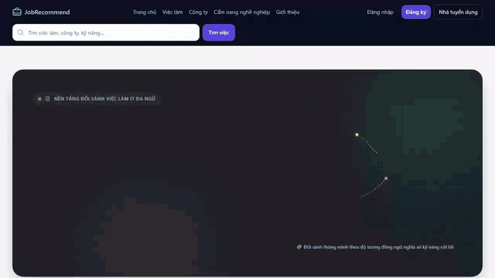
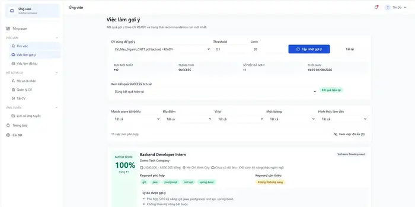
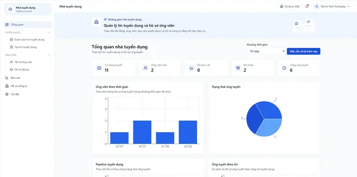
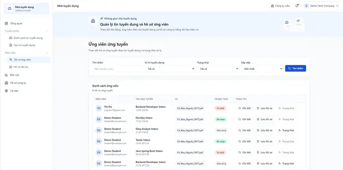
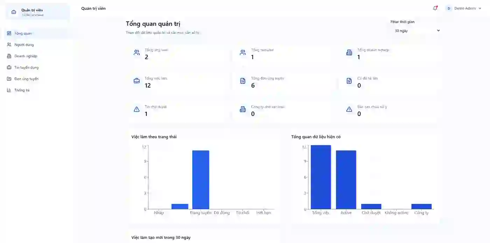

<div align="center">

# Hệ thống Gợi ý Việc làm Sinh viên IT (Student Job Recommendation System)

**Nền tảng tuyển dụng & gợi ý việc làm song ngữ Việt–Anh ứng dụng Content-Based Filtering, TF-IDF + Cosine Similarity, chuẩn hóa kỹ năng canonical và kiến trúc xếp hạng hai tầng V3.**

[](#ki%E1%BA%BFn-tr%C3%BAc-h%E1%BB%87-th%E1%BB%91ng)
[](#ki%E1%BA%BFn-tr%C3%BAc-h%E1%BB%87-th%E1%BB%91ng)
[](#ki%E1%BA%BFn-tr%C3%BAc-h%E1%BB%87-th%E1%BB%91ng)
[](#ki%E1%BA%BFn-tr%C3%BAc-h%E1%BB%87-th%E1%BB%91ng)
[](#c%C6%A1-s%E1%BB%9F-d%E1%BB%AF-li%E1%BB%87u--di-tr%C3%BA-flyway)

[Tổng quan](#t%E1%BB%95ng-quan) · [Video Demo & Giao diện](#video-demo--giao-di%E1%BB%87n-th%E1%BB%B1c-t%E1%BA%BF) · [Thuật toán V3](#thu%E1%BA%ADt-to%C3%A1n-x%E1%BA%BFp-h%E1%BA%A1ng-song-ng%E1%BB%AF-v3) · [Khởi chạy nhanh](#kh%E1%BB%9Fi-ch%E1%BA%A1y-nhanh) · [Kiểm chứng 18/11/2026](#k%E1%BA%BFt-qu%E1%BA%A3-ki%E1%BB%83m-ch%E1%BB%A9ng-to%C3%A0n-h%E1%BB%87-th%E1%BB%91ng-18112026) · [Tài liệu](#t%C3%A0i-li%E1%BB%87u-k%E1%BB%B9-thu%E1%BA%ADt)

</div>

---

## Tổng quan

**Student Job Recommendation System** (`JobRecommend`) kết nối **Ứng viên (Sinh viên IT)**, **Nhà tuyển dụng (Doanh nghiệp)** và **Quản trị viên** quanh một luồng đối sánh dữ liệu minh bạch, có giải thích kỹ năng khớp/thiếu và lưu lịch sử tái lập trên PostgreSQL:

- **Ứng viên (`STUDENT`)**: Quản lý hồ sơ atomic có kiểm soát xung đột ETag (`If-Match`), tải CV định dạng PDF/DOCX để AI phân tích thành snapshot `READY` (`processedText`, kỹ năng chuẩn hóa, `languageCode`, `languageConfidence`, `processingVersion`), nhận gợi ý việc làm V3 có giải thích chi tiết, lưu việc làm/tìm kiếm, ứng tuyển/rút đơn/ứng tuyển lại sau `REJECTED`, trao đổi tin nhắn, phỏng vấn, lời mời và thông báo.
- **Nhà tuyển dụng (`COMPANY`)**: Đăng ký doanh nghiệp, xác thực hồ sơ pháp lý và tài liệu, tạo và quản lý vòng đời tin tuyển dụng (`DRAFT` → `PENDING_APPROVAL` → `ACTIVE`/`REJECTED`/`CLOSED`), xem danh sách ứng viên & CV được phân quyền, cập nhật trạng thái đơn ứng tuyển, chạy **Xếp hạng ứng viên V3** hai tầng độc lập, lưu ứng viên, mời ứng tuyển, hẹn phỏng vấn và xem báo cáo phân tích.
- **Quản trị viên (`ADMIN`)**: Duyệt xác thực doanh nghiệp (`PENDING` / `VERIFIED` / `BLOCKED`), kiểm duyệt tin tuyển dụng (`PENDING_APPROVAL` → `ACTIVE` / `REJECTED`), giám sát người dùng, đơn ứng tuyển và thống kê toàn nền tảng.

> [!NOTE]
> Phiên bản trên nhánh `prototype/nova-motion-homepage` bao gồm bản thiết kế **NOVA MOTION** đang chờ nghiệm thu cho **Trang chủ công khai (`/`)** (nền Midnight `#0C111C`, bề mặt Porcelain `#F7F8F6`, điểm nhấn Signal Lime `#D5F36A`, Sunset Coral `#FF7956`, Ocean Teal `#237D70`, GSAP + ScrollTrigger) kết nối trực tiếp dữ liệu thật từ Backend Spring Boot và FastAPI AI Service.

---

## Video Demo & Giao diện thực tế

Tất cả hình ảnh và video dưới đây được **quay trực tiếp từ trình duyệt Chromium chạy full-stack thật** (Vite + Spring Boot + FastAPI + PostgreSQL 17) trên môi trường cô lập `NeoAuroraBrowserFixture`. Toàn bộ số liệu thống kê xuất hiện trong video (`16` việc làm đang tuyển, `4` sinh viên đang hoạt động, `3` công ty đã xác thực, `4` đơn ứng tuyển), tên doanh nghiệp (`NovaTech Digital Vietnam`, `Sao Mai Cloud Lab`, `Demo Tech Company`), CV (`datn-e2e-v1-khoa-en.pdf`) và tài khoản `.invalid` đều là **dữ liệu fixture tổng hợp (`synthetic fixture data`)**, không phải số liệu vận hành hay dữ liệu cá nhân/doanh nghiệp thật.

### 1. Showcase chuyển động Trang chủ NOVA MOTION (16:9)

<p align="center">
  
</p>

- **Video Showcase Homepage (MP4, 1280×720, 15.87s, ~2.12 MiB)**: [`docs/media/nova-motion-homepage-showcase.mp4`](docs/media/nova-motion-homepage-showcase.mp4) *(liên kết tương đối tới tệp MP4 trong repo; trên GitHub mở trang tệp để xem raw/tải về, còn ảnh GIF phía trên phát lặp trực tiếp trong README)*.
- **Video Walkthrough Full-Stack Đa vai trò (MP4, 1280×720, 40.23s, ~3.39 MiB)**: [`docs/media/full-stack-functional-walkthrough.mp4`](docs/media/full-stack-functional-walkthrough.mp4) — trình diễn Public Homepage & Tìm việc → Sinh viên phân tích CV & Gợi ý V3 (`PRIMARY`/`FALLBACK` + modal giải thích) → Nhà tuyển dụng Xếp hạng ứng viên V3 & Dashboard → Quản trị viên xác thực doanh nghiệp & duyệt tin tuyển dụng *(liên kết tương đối tới tệp MP4 trong repo)*.

<details>
<summary>Xem ảnh chụp giao diện các phân hệ (Sinh viên, Nhà tuyển dụng, Quản trị viên)</summary>

| Phân hệ Ứng viên — Quản lý CV | Phân hệ Ứng viên — Gợi ý việc làm V3 |
| :---: | :---: |
|  |  |

| Phân hệ Nhà tuyển dụng — Tổng quan | Phân hệ Nhà tuyển dụng — Quản lý ứng viên |
| :---: | :---: |
|  |  |

| Phân hệ Quản trị — Tổng quan | Phân hệ Quản trị — Quản lý người dùng |
| :---: | :---: |
|  |  |

</details>

---

## Kiến trúc hệ thống

```text
+--------------------------+        REST JSON + JWT         +----------------------------------+
|  Frontend SPA            | <----------------------------> |  Backend System of Record        |
|  React + TS + Vite       |     /api proxy -> :8080        |  Spring Boot 3.5 / Java 21       |
|  Tailwind + GSAP Motion  |                                |  Security, RBAC, State, Flyway   |
+--------------------------+                                +----------------+-----------------+
                                                                             | Internal HTTP (No JWT)
                                                                             v
+--------------------------+                                +----------------------------------+
|  PostgreSQL 17           | <----------------------------> |  Stateless AI Service (:8000)    |
|  Flyway V1..V25          |       JPA / JDBC (:55432)      |  FastAPI / Python 3.11.9         |
|  Persistent Volumes      |                                |  PDF/DOCX + Bilingual NLP + V3   |
+--------------------------+                                +----------------------------------+
```

| Thành phần | Công nghệ chính | Trách nhiệm cốt lõi |
| :--- | :--- | :--- |
| **`frontend/`** | React, TypeScript, Vite, Tailwind CSS, GSAP (`@gsap/react`), Axios | 108 khai báo route (Public, Auth, Candidate, Recruiter, Admin), NOVA MOTION trên `/`, giữ nguyên ETag `If-Match` và cô lập phiên theo `sessionStorage`. |
| **`backend/`** | Java 21, Spring Boot 3.5.x, Spring Security JWT, JPA/Hibernate, Flyway, Testcontainers | Nguồn sự thật duy nhất về auth/RBAC, nghiệp vụ đơn/tin/xác thực, điều phối AI ngoài DB transaction, kiểm tra phản hồi AI và gán `rankPosition` / `tierRankPosition`. |
| **`ai-service/`** | Python 3.11.9, FastAPI, Pydantic v2, scikit-learn, `underthesea`, `pdfplumber`, `python-docx` | Trích xuất PDF/DOCX, nhận diện ngôn ngữ EN/VI, chuẩn hóa kỹ năng (`bilingual-nlp-v2-skills-v1`), tính TF-IDF + Cosine Similarity và giải thích kết quả. |
| **Database** | PostgreSQL 17 + Flyway (`V1`–`V25`) | Lưu hồ sơ, CV snapshot, recommendation/ranking runs, partial unique index ứng tuyển (`V18`), revision lạc quan (`V19`), messaging, phỏng vấn và thông báo. |

### Cơ sở dữ liệu & di trú Flyway

- Toàn bộ schema được quản lý tuần tự bằng Flyway từ `V1` đến `V25` (`backend/src/main/resources/db/migration/`).
- Dữ liệu demo cục bộ chạy qua Docker Compose dùng named volume `postgres_data` (port `55432`) và `cv_uploads`. Không sửa đổi migration đã phát hành.

---

## Thuật toán xếp hạng song ngữ V3

Hệ thống tách riêng bước tiền xử lý CV (`POST /internal/v2/cv/parse`) với bước chấm điểm V3 (`POST /internal/v3/recommendations`, `POST /internal/v3/candidate-rankings`), tuyệt đối không phát hiện ngôn ngữ lại khi chấm điểm.

| Tầng (`rankingTier`) | Chiến lược (`scoringStrategy`) | Điều kiện áp dụng | Công thức tính `rankingScore` |
| :--- | :--- | :--- | :--- |
| **`PRIMARY`** | `SAME_LANGUAGE_HYBRID` | CV & Job cùng ngôn ngữ EN hoặc VI, độ tin cậy ngôn ngữ đạt ngưỡng | Nếu Job có kỹ năng: `0.65 * textScore + 0.35 * skillScore` (`overallScore = rankingScore`)<br/>Nếu Job không khai báo kỹ năng: `textScore` (`skillScore = 0`) |
| **`FALLBACK`** | `CROSS_LANGUAGE_SKILL_BASED` | Khác ngôn ngữ (VI ↔ EN) hoặc độ tin cậy ngôn ngữ/ngữ liệu hỗn hợp chưa đủ | `rankingScore = skillScore`; `textScore = null`; `overallScore = null` |

- **Nguyên tắc phân tầng**: Điểm giữa `PRIMARY` và `FALLBACK` **không thuộc cùng thang đo chuẩn hóa**. Student V3 luôn xếp toàn bộ `PRIMARY` trước `FALLBACK` (`rankingScore DESC, jobId ASC` trong từng tầng) và gán `rankPosition` + `tierRankPosition`; Company Candidate Ranking V3 sử dụng `primaryLimit` và `fallbackLimit` độc lập. Chi tiết hợp đồng tại [`docs/recommendation-ranking-v3-contract.md`](docs/recommendation-ranking-v3-contract.md).

---

## Khởi chạy nhanh

### 1. Chạy Core Stack bằng Docker Compose

Yêu cầu: Docker Desktop (Linux containers), Node.js 20+, Java 21 (khi chạy test Backend/E2E). Tham khảo chi tiết tại [`docs/docker-core.md`](docs/docker-core.md) và [`docs/runbook.md`](docs/runbook.md).

```powershell
# Khởi tạo biến môi trường từ mẫu nếu chưa có .env
copy .env.example .env

# Khởi chạy PostgreSQL 17 (:55432), AI Service (:8000) và Backend (:8080)
docker compose up -d
docker compose ps
```

### 2. Chạy Frontend Development Server (`localhost:5173`)

```powershell
cd frontend
npm install
npm run dev
```

Mở trình duyệt tại `http://localhost:5173` (mọi request `/api/**` được Vite dev server proxy sang `http://127.0.0.1:8080`).

### 3. Lệnh kiểm chứng tự động chuẩn của dự án

```powershell
# Frontend unit/integration, lint & build
cd frontend && npm run test:run && npm run lint && npm run build

# Backend unit & PostgreSQL Testcontainers integration suite
cd backend && .\mvnw.cmd -B -ntp clean verify

# Core Smoke V3 cô lập (Docker + Testcontainers)
.\scripts\smoke-core.ps1

# Toàn bộ suite E2E cô lập & UI/UX Acceptance (NeoAuroraBrowserFixture)
.\scripts\run-neo-aurora-isolated-e2e.ps1 -RunName my-isolated-run
.\scripts\run-application-messaging-isolated-e2e.ps1
.\scripts\run-company-verification-isolated-e2e.ps1
.\scripts\run-recruiting-workflows-isolated-e2e.ps1
.\scripts\run-settings-notifications-isolated-e2e.ps1 -Suite notifications
.\scripts\run-settings-notifications-isolated-e2e.ps1 -Suite analytics
.\scripts\run-settings-notifications-isolated-e2e.ps1 -Suite reliability
```

---

## Kết quả kiểm chứng toàn hệ thống (18/11/2026)

Kiểm chứng được thực hiện trên nhánh **`prototype/nova-motion-homepage`** (base commit `1158dd7abb8868f7fd03b74a3584ea78522de741`) với **full-stack thật** (PostgreSQL 17, FastAPI AI Service, Spring Boot Backend, React/Vite Frontend) chạy trong các môi trường cô lập dùng tài khoản tổng hợp.

### 1. Tổng hợp Automated Test Suites

| Bộ kiểm thử | Phạm vi & Môi trường | Kết quả |
| :--- | :--- | :---: |
| **Backend (`.\mvnw.cmd -B -ntp clean verify`)** | 249 unit tests + 432 PostgreSQL 17 Testcontainers IT (`V1–V25`) *(ghi chú: `RecruitingWorkflowsBrowserFixture` sau đó được cập nhật `"24"` → `"25"` và xác minh lại qua runner cô lập riêng)* | **681 / 681 PASS** |
| **AI Service (`pytest` trong container Python 3.11.9)** | `pip check` sạch + toàn bộ NLP, PDF/DOCX extraction, bilingual skill & V3 scoring tests | **887 / 887 PASS** |
| **Frontend (`vitest`, `eslint`, `vite build`)** | 57 test files (UI components, pages, contracts, mappers), ESLint strict (`0` warnings), production build | **564 / 564 PASS · Lint 0 · Build PASS** |
| **Core Smoke V3 (`scripts/smoke-core.ps1`)** | Docker Compose cô lập kiểm chứng Flyway V1–V25, AI V3 recommendation (`1` call V3, `0` V2 fallback) | **PASS (`exit 0`)** |
| **Default Isolated E2E (`run-neo-aurora-isolated-e2e.ps1`)** | 67 test cases Playwright thực tế (`api`, `application-lifecycle`, `browser`, `company-analytics`, `company-candidates`, `moderation`, `own-jobs`, `profile-atomic`, `routes` 108/83, `security`, `settings-notifications`, `w1a`) | **67 / 67 PASS** |
| **UI/UX Acceptance (`uiux-acceptance.spec.mjs`)** | 11 kịch bản U01–U11, kiểm tra keyboard trap, focus recovery, offline error & axe-core accessibility | **11 / 11 PASS (`0` vi phạm axe)** |
| **Application & Messaging (`M01–M10`)** | `run-application-messaging-isolated-e2e.ps1` — luồng hội thoại đơn ứng tuyển & phân quyền | **10 / 10 PASS** |
| **Company Verification (`B3-01–B3-06`)** | `run-company-verification-isolated-e2e.ps1` — tài liệu xác thực riêng tư & kiểm soát trạng thái | **6 / 6 PASS** |
| **Recruiting Workflows (`E01–E10`)** | `run-recruiting-workflows-isolated-e2e.ps1` — phỏng vấn, lời mời ứng tuyển & SQL integrity | **10 / 10 PASS** |
| **Notifications / Analytics / Reliability** | `run-settings-notifications-isolated-e2e.ps1` (`notifications`, `analytics`, `reliability`) | **6 + 6 + 26 = 38 PASS** |
| **Scripted Multi-Role Browser Verification (18/11/2026)** | Read-only Live `localhost:5173` (`P01–P03`) + Isolated Admin (`A01–A02`), Company hydration `C01`, `C02`, Student bilingual PDF/DOCX → V3 (`S04–S10`), Company Ranking V3 mixed tier (`C06`), Messaging/Notif (`M01–M04`, `N01`), RBAC `401/403` | **100% PASS (`0` page/console errors)** |

### 2. Đo lường hiệu năng Trang chủ NOVA MOTION (Chromium `141.0.7390.37`)

| Mục tiêu & Viewport | Cold LCP (p50) | Warm LCP (p50) | Max CLS | Max Event Latency | Frame Timing (144 frames) | Overflow / Axe Violations |
| :--- | :---: | :---: | :---: | :---: | :---: | :---: |
| **`localhost:5173` (Dev) — Desktop `1440px`** | `752 ms` | `600 ms` | **`0`** | `104 ms` | **`60 FPS`** (mean `16.67 ms`, `0` frames > 33ms) | `0` overflow · `0` axe (default & modal) |
| **`localhost:5173` (Dev) — Mobile `390px`** | `1160 ms` | `1028 ms` | **`0`** | `48 ms` | **`60 FPS`** (mean `16.67 ms`, `0` frames > 33ms) | `0` overflow · `0` axe |
| **`127.0.0.1:5177` (Prod Preview) — Desktop `1440px`** | `580 ms` | `536 ms` | **`0`** | `104 ms` | **`59.6 FPS`** (mean `16.78 ms`, `0` frames > 33ms) | `0` overflow · `0` axe (default & modal) |
| **`127.0.0.1:5177` (Prod Preview) — Mobile `390px`** | `972 ms` | `912 ms` | **`0`** | `32 ms` | **`60 FPS`** (mean `16.67 ms`, `0` frames > 33ms) | `0` overflow · `0` axe |
| **Reduced Motion & States** | — | — | — | — | `prefers-reduced-motion`: `cvCardDeltaY = 0` | Loading / Error / Empty states: **Verified** |

### 3. Phân định Bằng chứng Tự động, Trạng thái Manual UAT & Trường hợp Biên chưa chạy

- **Bằng chứng kiểm thử tự động (Automated E2E & Integration Evidence)**: Toàn bộ kết quả ở Mục 1–2 phía trên là chạy tự động (Maven/Testcontainers, Container pytest, Vitest, Core Smoke, Playwright trên full-stack thật với dữ liệu tổng hợp), **không thay thế** biên bản thao tác tay của con người.
- **Trạng thái Manual UAT (`NOT TESTED` — Chưa ký nghiệm thu thủ công)**: Theo quy chuẩn W4-D (`w4d-manual-uat-checklist.md`), các bước UAT thủ công do người trình bày thực hiện trước hội đồng vẫn giữ trạng thái **`NOT TESTED`** cho đến khi người kiểm tra trực tiếp thao tác và ký xác nhận độc lập.
- **Các trường hợp biên / nhánh phụ chưa chạy trên trình duyệt thật**:
  - Hai script PowerShell thế hệ cũ (`run-student-recommendation-upload-real-e2e.ps1`, `run-candidate-ranking-real-e2e.ps1`) **chủ đích `NOT TESTED`** để giữ cô lập môi trường Docker (đã được thay thế bằng các runner Testcontainers cô lập).
  - Một số nhánh chi tiết hiện chỉ xác minh bằng **Vitest (HTTP giả lập)** chứ chưa chạy riêng bằng Playwright full-stack: tự động chuyển tab ẩn + focus ô GPA lỗi trên `/candidate/profile/edit` (`S02`), và chỉnh sửa `logoUrl`/`coverImageUrl` + fallback ảnh lỗi trên `/recruiter/company/edit` (`C01`).
  - Một số thao tác điều hướng phụ chưa tự động hóa hết trong E2E: nút `Back/Forward` trình duyệt trên `/jobs` (`P02`), gửi form đăng ký sai định dạng trên `/register/candidate` (`S01`), bấm nút đổi CV active happy-path + reload (`S06` — đã test API ở `A03` và nút offline ở `B13`), và quét đủ toàn bộ 25 route `/admin/*` trong `routes.spec.mjs` (`R01` quét 83 route non-admin; 7 trang `/admin/*` chính được kiểm chứng qua kịch bản trình duyệt).

> *(Ghi chú lịch sử: các tài liệu báo cáo đợt `03/08/2026` trong `docs/datn/` và `docs/final-verification.md` phản ánh mốc baseline trước nhánh prototype này.)*

---

## Hạn chế hiện tại & Lưu ý triển khai

- **Phạm vi thiết kế NOVA MOTION**: Giao diện mới hiện chỉ áp dụng có kiểm soát cho Trang chủ công khai (`/`) và phần header/card liên quan; các trang Quản trị viên (`/admin/**`) giữ nguyên bố cục chức năng hiện có theo phạm vi pha thử nghiệm.
- **Môi trường AI Service trên Windows Host**: Chính sách Application Control của một số máy Windows có thể chặn DLL gốc của `underthesea_core` khi chạy trực tiếp trên Python host; bộ test AI đạt **887/887 PASS** khi chạy qua Docker image Linux chính thức (`python:3.11.9`).
- **Tích hợp & Giới hạn đã biết**: Chi tiết đầy đủ về các tính năng chưa hỗ trợ (quên/đặt lại mật khẩu qua email thực, thanh toán, tải ảnh trực tiếp thay vì URL ảnh công ty, phân tích ngưỡng song ngữ) được ghi nhận minh bạch tại [`docs/known-limitations.md`](docs/known-limitations.md).

---

## Tài liệu kỹ thuật

- Kiến trúc & Vận hành: [`docs/README.md`](docs/README.md) · [`docs/runbook.md`](docs/runbook.md) · [`docs/docker-core.md`](docs/docker-core.md)
- Hợp đồng API & Thuật toán V3: [`docs/api-contract.md`](docs/api-contract.md) · [`docs/recommendation-ranking-v3-contract.md`](docs/recommendation-ranking-v3-contract.md) · [`docs/candidate-ranking-contract.md`](docs/candidate-ranking-contract.md)
- Cơ sở dữ liệu & Hiệu năng: [`docs/database-schema.md`](docs/database-schema.md) · [`docs/database-erd.dbml`](docs/database-erd.dbml) · [`docs/backend-performance-baseline.md`](docs/backend-performance-baseline.md)
- Tài liệu Kiểm thử & Nghiệm thu: [`e2e/README.md`](e2e/README.md) · [`docs/final-verification.md`](docs/final-verification.md) · [`docs/datn/README.md`](docs/datn/README.md) · [`docs/known-limitations.md`](docs/known-limitations.md)

---

## Nhóm thực hiện

**Bindev** · **Thi** — Dự án Tốt nghiệp / Đồ án Hệ thống Gợi ý Việc làm Sinh viên IT.
