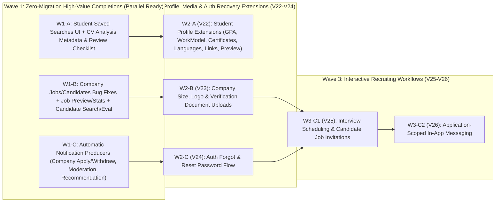

# DATN Wave 0 — Full Feature Implementation Plan

- **Repository:** `binkadev/student-job-recommendation-system`
- **Baseline Branch & Commit:** `master` @ `f3b0e75f`
- **Latest Released Flyway Migration:** `V21__settings_optimistic_concurrency.sql`
- **Companion Audit Document:** [`docs/datn/full-feature-gap-matrix.md`](./full-feature-gap-matrix.md)
- **Governance & Contracts:** `AGENTS.md`, `docs/datn/CODEX_GUARDRAILS.md`, `docs/recommendation-ranking-v3-contract.md`

---

## 1. Architectural Guardrails & Non-Negotiable Invariants

1. **V3 AI & NLP Pipeline Isolation:**
   - Do **not** modify `ai-service/` V3 scoring, TF-IDF vectorization, canonical skill dictionary, or `bilingual-nlp-v2-skills-v1` preprocessing. Keep Bao's AI/data evaluation work completely separate.
   - Student Recommendation (`POST /internal/v3/recommendations`) and Company Candidate Ranking (`POST /internal/v3/candidate-rankings`) must continue consuming persisted READY CV snapshots (`processedText`, `skills`, `languageCode`, `languageConfidence`, `processingVersion`).
   - Keep `PATCH /api/students/me/cv/{cvId}/extracted-data` as `501 FEATURE_NOT_SUPPORTED` so persisted CV analysis snapshots cannot be mutated out-of-band.
2. **Database & Migration Discipline:**
   - Never modify `V1`–`V21` Flyway migrations.
   - All new schema changes start at **`V22`** and must be strictly additive (no destructive drops, no resets, preserve all demo users, CVs, jobs, applications, and AI runs).
   - Coordinate Flyway version numbers across workstreams before branching:
     - **Wave 1** uses **zero Flyway migrations** (100% compatible with `V21`), eliminating cross-PR migration conflicts.
     - **Wave 2** reserves **`V22`** (Workstream A: Student Profile Extensions) and **`V23`** (Workstream B: Company Media/Verification Extensions).
     - **Wave 3** reserves **`V24`** (Auth Password Recovery), **`V25`** (Interviews & Invitations), and **`V26`** (In-App Messaging).
3. **File & Module Isolation Across Parallel Workstreams:**
   - Each parallel workstream owns distinct Frontend page directories and Backend module packages so parallel PRs merge cleanly without conflict.

---

## 2. Recommended Parallel Gravity Workstreams (Up to 3 Non-Conflicting Streams)

| Workstream | Scope & Ownership | Owned Frontend Files | Owned Backend Modules |
| :--- | :--- | :--- | :--- |
| **Workstream A — Student Workspace Completion** | Student Saved Searches UI, CV Analysis V2 metadata & deterministic CV Review checklist, Student Profile academic/work-model fields & structured extensions (`certificates`, `languages`, `links`, self-preview modal). | `frontend/src/pages/candidate/CandidateJobsPage.tsx` `frontend/src/pages/candidate/CandidateCvsPage.tsx` `frontend/src/pages/candidate/CandidateProfilePage.tsx` `frontend/src/features/candidate/profile/**` | `modules/savedsearch/**` `modules/cv/**` `modules/student/**` `V22` (Wave 2) |
| **Workstream B — Company Workspace & Recruitment Operations** | Fix Company profile & candidate filter `/companies/me/jobs` bugs, Job Skill `importance`/`minLevel` & content limits, Job Preview & Per-Job Statistics views, Candidate Evaluation & Applicant/Saved-Candidate Search, Company `companySize`/`logoUrl`/verification uploads. | `frontend/src/pages/recruiter/RecruiterCompanyPage.tsx` `frontend/src/pages/recruiter/RecruiterJobsPage.tsx` `frontend/src/pages/recruiter/RecruiterCandidatesPage.tsx` | `modules/company/**` `modules/job/**` `modules/savedcandidate/**` `V23` (Wave 2) |
| **Workstream C — Notifications, Auth Recovery & Interactive Workflows** | Automatic Notification Producers (`APPLICATION_STATUS_CHANGED` to Company, `JOB_STATUS_CHANGED`, `SYSTEM`, `RECOMMENDATION`), Password Recovery (`/forgot-password`, `/reset-password`), Interviews, Job Invitations, and In-App Messaging. | `frontend/src/pages/auth/AuthFlowPage.tsx` `frontend/src/pages/candidate/CandidateInterviewsPage.tsx` `frontend/src/pages/recruiter/RecruiterInterviewsPage.tsx` `frontend/src/pages/candidate/CandidateInvitationsPage.tsx` `frontend/src/pages/candidate/CandidateMessagesPage.tsx` | `modules/notification/**` `modules/application/service/**` (notification hook) `modules/recommendation/service/**` (notification hook) `modules/auth/**` New `modules/interview/**`, `modules/invitation/**`, `modules/message/**` `V24`–`V26` (Wave 2/3) |

---

## 3. Master Task Breakdown & Dependency Order

---

## 4. Exact Wave 1 Tasks (Immediate Execution Queue — Zero Schema Migrations)

### Task `W1-A`: Student Saved Searches Wiring + CV V2 Metadata & Deterministic Review Checklist
- **Workstream:** Workstream A (Student Workspace)
- **Priority:** `P0`
- **Dependencies:** None (`master` @ `f3b0e75f`, uses existing `V10`, `V14`, `V15` tables)
- **Closes Gaps:** `STU-07`, `STU-08`, `STU-14`
- **Affected Modules:**
  - Frontend: `frontend/src/constants/routes.ts`, `frontend/src/app/router/appRouter.tsx`, `frontend/src/pages/candidate/CandidateJobsPage.tsx`, `frontend/src/pages/candidate/CandidateCvsPage.tsx`
  - Backend: None required (uses existing `SavedSearchController` `/api/students/me/saved-searches` and `CvController` `GET /api/students/me/cv/{cvId}/analysis`)
- **Required APIs & Migrations:**
  - No Flyway migration.
  - Consumes `GET/POST/PUT/DELETE /api/students/me/saved-searches` and `GET /api/students/me/cv/{cvId}/analysis`.
- **Implementation Scope:**
  1. **Saved Searches (`STU-14`):** Add `/candidate/jobs/saved-searches` route in `routes.ts` and `appRouter.tsx` (`<CandidateJobsPage mode="saved-searches" />`), add navigation actions between `/candidate/jobs` and `/candidate/jobs/saved-searches`, and add an "Áp dụng bộ lọc" (Apply search criteria) action that navigates to `/candidate/jobs?keyword=...&location=...&jobType=...` and populates the search state.
  2. **CV V2 Analysis Metadata (`STU-07`):** Expand `CvAnalysisResponse` in `CandidateCvsPage.tsx` to map and display `languageCode` (`en`/`vi`), `languageConfidence`, `processingVersion` (`bilingual-nlp-v2-skills-v1`), `analyzedAt`, and `warnings` on `/candidate/cvs/:cvId/analysis`.
  3. **CV Deterministic Review View (`STU-08`):** Differentiate `/candidate/cvs/:cvId/review` (`mode="review"`) from `mode="analysis"` by rendering a deterministic CV Readiness & Completeness scorecard derived from the persisted V2 analysis (`status === READY`, language confidence threshold $\ge 0.65$, extracted canonical skills count, text length/section coverage, and actionable improvement suggestions without calling external AI).
- **Test & Verification Criteria:**
  - Frontend unit/component tests for `CandidateJobsPage` (`mode="saved-searches"` + filter application) and `CandidateCvsPage` (`mode="analysis"` metadata + `mode="review"` checklist).
  - Keep `UnsupportedCapabilities.test.tsx` passing for `/candidate/cvs/templates`, `/builder`, and `/edit-extracted-data`.

---

### Task `W1-B`: Company Workspace Bug Fixes, Job Preview/Statistics & Candidate Search/Evaluation
- **Workstream:** Workstream B (Company Workspace)
- **Priority:** `P0`
- **Dependencies:** None (`master` @ `f3b0e75f`, uses existing `CompanyJobController`, `CompanyAnalyticsController`, `ApplicationController`, `SavedCandidateController`, `CandidateRankingController`)
- **Closes Gaps:** `COM-04`, `COM-08`, `COM-09`, `COM-10`, `COM-12`, `COM-14`, `COM-15`
- **Affected Modules:**
  - Frontend: `frontend/src/pages/recruiter/RecruiterCompanyPage.tsx`, `frontend/src/pages/recruiter/RecruiterJobsPage.tsx`, `frontend/src/pages/recruiter/RecruiterCandidatesPage.tsx`, `frontend/src/pages/UnsupportedCapabilities.test.tsx`
  - Backend: None required (all Backend endpoints already exist and are verified)
- **Required APIs & Migrations:**
  - No Flyway migration.
  - Uses `GET /api/companies/me/jobs`, `GET /api/jobs/{id}`, `GET /api/companies/me/recruitment-report?jobId={id}`, `GET /api/companies/me/applications`, `GET/POST/PATCH /api/companies/me/saved-candidates`, and `GET /api/companies/me/jobs/{jobId}/candidate-ranking-runs`.
- **Implementation Scope:**
  1. **Fix `RecruiterCompanyPage.tsx` Own-Jobs Fetch (`COM-04`):** Replace `GET /api/jobs?page=1&size=100` client-side filter in `getCompanyJobs` with `GET /api/companies/me/jobs?page=1&size=20&status=ACTIVE`.
  2. **Fix `RecruiterCandidatesPage.tsx` Job Filter Dropdown (`COM-12`):** Replace the `while` loop over `/companies/me/applications` in `getCompanyJobs` with `GET /api/companies/me/jobs?page=1&size=100`.
  3. **Job Form Skill Metadata & Realistic Content Limits (`COM-08`):** In `RecruiterJobsPage.tsx`, allow recruiters to set `importance` (`REQUIRED`, `PREFERRED`, `NICE_TO_HAVE`) and `minLevel` (`BEGINNER`, `INTERMEDIATE`, `ADVANCED`) per selected job skill, and align frontend validation limits with Backend `JobRequest` (`maxJobTitleLength = 255`, `maxJobContentLength = 5000`).
  4. **Recruiter Job Preview & Per-Job Statistics (`COM-09`):** Replace `UnsupportedJobView` on `/recruiter/jobs/:jobId/preview` with a recruiter job preview card rendering full job details, skill badges with importance/level, and moderation status; replace `UnsupportedJobView` on `/recruiter/jobs/:jobId/statistics` with per-job application funnel metrics and recent applicants using `GET /api/companies/me/recruitment-report?jobId={jobId}` and `GET /api/companies/me/jobs/{jobId}/applications`.
  5. **Candidate Evaluation & Applicant/Saved-Candidate Search (`COM-14`, `COM-15`):** Enhance `/recruiter/candidates/:candidateId/evaluation` with an integrated evaluation panel (save/update `saved_candidates` note with `If-Match` revision + quick status transition + link to job V3 AI ranking); enable `/recruiter/candidate-search` (`mode="search"`) to search/filter across the company's own applicants and saved candidates with a direct launcher to per-job V3 AI Candidate Ranking.
- **Test & Verification Criteria:**
  - Update `frontend/src/pages/UnsupportedCapabilities.test.tsx` to reflect newly supported `/recruiter/jobs/:jobId/preview`, `/statistics`, and `/recruiter/candidate-search` views, and add component tests verifying `GET /api/companies/me/jobs` is used and real metrics/notes render.

---

### Task `W1-C`: Complete Automatic Notification Producers (Company Apply/Withdraw, Moderation, Student V3 Recommendation)
- **Workstream:** Workstream C (Notifications & Cross-Cutting)
- **Priority:** `P0`
- **Dependencies:** None (`master` @ `f3b0e75f`, uses existing `notifications` table `V12` and `user_notification_settings` table `V13`)
- **Closes Gaps:** `NOTIF-02`, `NOTIF-03`, `NOTIF-04`
- **Affected Modules:**
  - Backend:
    - `backend/src/main/java/com/tttn/jobrecommendation/modules/notification/service/**`
    - `backend/src/main/java/com/tttn/jobrecommendation/modules/application/service/ApplicationServiceImpl.java`
    - `backend/src/main/java/com/tttn/jobrecommendation/modules/job/service/JobServiceImpl.java`
    - `backend/src/main/java/com/tttn/jobrecommendation/modules/company/service/CompanyServiceImpl.java`
    - `backend/src/main/java/com/tttn/jobrecommendation/modules/recommendation/service/RecommendationServiceImpl.java`
  - Frontend: `frontend/src/pages/candidate/CandidateNotificationsPage.tsx`, `frontend/src/pages/recruiter/RecruiterNotificationsPage.tsx` (verify deep-link navigation by `referenceType` / `referenceId`)
- **Required APIs & Migrations:**
  - No Flyway migration (`notifications` and `user_notification_settings` already support `APPLICATION_STATUS_CHANGED`, `JOB_STATUS_CHANGED`, `RECOMMENDATION`, `SYSTEM` and reference types `APPLICATION`, `JOB`, `RECOMMENDATION_RUN`, `SYSTEM`).
- **Implementation Scope:**
  1. **Company Application Notifications (`NOTIF-02`):** Emit `APPLICATION_STATUS_CHANGED` (`referenceType = APPLICATION`) to `job.getCompany().getUser()` when a Student submits a new application (`applyForJob`) or withdraws an application (`PENDING -> WITHDRAWN`), gated by the company user's `application_status_enabled` setting.
  2. **Company Moderation Notifications (`NOTIF-03`):** Emit `JOB_STATUS_CHANGED` (`referenceType = JOB`) to the company user when Admin approves or rejects a `PENDING_APPROVAL` job (gated by `job_status_enabled`), and emit `SYSTEM` (`referenceType = SYSTEM`) when Admin verifies or blocks a company (gated by `system_enabled`).
  3. **Student Recommendation Notification (`NOTIF-04`):** Emit `RECOMMENDATION` (`referenceType = RECOMMENDATION_RUN`, `referenceId = run.getId()`) to the student user in `RecommendationServiceImpl` when a V3 recommendation run (`POST /api/students/me/recommendations/generate`) completes with `SUCCEEDED`, gated by `recommendation_enabled`.
- **Test & Verification Criteria:**
  - Backend unit & PostgreSQL Testcontainers integration tests verifying each producer creates the notification when the corresponding `user_notification_settings` flag is `true` and suppresses it when `false`.

---

## 5. Wave 2 Tasks (Additive Schema Extensions `V22`–`V24`)

### Task `W2-A`: Student Profile Academic/Work-Model Wiring, Structured Extensions & Public Profile Preview (`V22`)
- **Workstream:** Workstream A
- **Priority:** `P1`
- **Dependencies:** `W1-A`
- **Closes Gaps:** `STU-03`, `STU-04`, `STU-05`
- **Migration:** `V22__student_profile_extensions.sql`
  - Add `github_url VARCHAR(500)`, `linkedin_url VARCHAR(500)`, `portfolio_url VARCHAR(500)`, `certificates_json TEXT`, `languages_json TEXT` to `student_profiles` (existing `gpa`, `education_level`, `preferred_working_model` columns from `V2`/`V9` are already in `student_profiles`).
- **Affected Modules:**
  - Backend: `modules/student/entity/StudentProfile.java`, `dto/request/StudentProfileAggregateRequest.java`, `dto/response/StudentProfileAggregateResponse.java`, `service/StudentServiceImpl.java` (maintained under single-transaction `If-Match` `profile_revision` ETag from `V19`).
  - Frontend: `CandidateProfilePage.tsx`, `CandidateProfileEditView.tsx`, `CandidatePreferencesView.tsx`, `candidateProfileService.ts`, `candidateProfileTypes.ts`.
- **Implementation Scope:**
  - Wire `gpa`, `educationLevel`, `preferredWorkingModel`, `githubUrl`, `linkedinUrl`, `portfolioUrl`, `certificates`, and `languages` into `GET/PUT /api/students/me/profile-aggregate` with `clearFields` support.
  - Add a "Xem hồ sơ công khai" self-preview dialog on `CandidateProfilePage.tsx` showing how recruiters view the candidate profile.
- **Test Criteria:**
  - Extend `StudentProfileAtomicSaveIntegrationTest` to verify atomic persistence, `clearFields`, and `428`/`409` ETag concurrency for the extended fields.

---

### Task `W2-B`: Company Size, Logo & Verification Metadata Extensions (`V23`)
- **Workstream:** Workstream B
- **Priority:** `P1`
- **Dependencies:** `W1-B`
- **Closes Gaps:** `COM-05`
- **Migration:** `V23__company_profile_extensions.sql`
  - (`company_size` and `logo_url` already exist in `companies` from `V2`). Add `cover_image_url VARCHAR(500)` and `verification_document_url VARCHAR(500)` to `companies` if needed.
- **Affected Modules:**
  - Backend: `modules/company/entity/Company.java`, `dto/request/UpdateCompanyRequest.java`, `dto/response/CompanyProfileResponse.java`, `PublicCompanyController.java`, `AdminCompanyController.java`, `CompanyServiceImpl.java`.
  - Frontend: `RecruiterCompanyPage.tsx`, `RecruiterCompanyCapabilities.test.tsx`.
- **Implementation Scope:**
  - Map `companySize` and `logoUrl` (plus optional `coverImageUrl`) in `Company.java`, `GET/PUT /api/companies/me` (protected by `V21` `If-Match` `account_revision`), `GET /api/public/companies/**`, and `GET /api/admin/companies/**`.
  - Add `POST /api/companies/me/logo` (multipart image upload with magic-byte validation PNG/JPG/WEBP up to 5MB and `GET /api/public/companies/{id}/logo` streaming) or validated URL support in `RecruiterCompanyPage.tsx`.
- **Test Criteria:**
  - Backend integration test verifying `companySize` and `logoUrl` round-trip through `/api/companies/me` with `If-Match` ETag and appear on `/api/public/companies/{id}`.

---

### Task `W2-C`: Authentication Forgot & Reset Password Flow (`V24`)
- **Workstream:** Workstream C
- **Priority:** `P1`
- **Dependencies:** `W1-C`
- **Closes Gaps:** `AUTH-06`
- **Migration:** `V24__password_reset_tokens.sql`
  - Create table `password_reset_tokens` (`id BIGSERIAL PRIMARY KEY`, `user_id BIGINT NOT NULL REFERENCES users(id)`, `token_hash VARCHAR(64) NOT NULL UNIQUE`, `expires_at TIMESTAMP NOT NULL`, `used_at TIMESTAMP`, `created_at TIMESTAMP NOT NULL DEFAULT CURRENT_TIMESTAMP`).
- **Affected Modules:**
  - Backend: `modules/auth/controller/AuthController.java`, `service/AuthServiceImpl.java`, `dto/request/ForgotPasswordRequest.java`, `dto/request/ResetPasswordRequest.java`.
  - Frontend: `frontend/src/pages/auth/AuthFlowPage.tsx`.
- **Required APIs:**
  - `POST /api/auth/forgot-password` (public, rate-safe, issues a single-use 15-minute reset token; in local/dev mode returns or logs the token according to environment configuration while preserving account enumeration safety).
  - `POST /api/auth/reset-password` (public, validates token hash, expiry, single-use, and BCrypt 6–72 byte password policy, then updates `users.password_hash`).
- **Test Criteria:**
  - Backend integration test for token generation, expiry, single-use enforcement, and password update + login with new password.

---

## 6. Wave 3 Tasks (Interactive Recruiting Workflows `V25`–`V26`)

### Task `W3-C1`: Interview Scheduling & Candidate Job Invitations (`V25`)
- **Workstream:** Workstream C
- **Priority:** `P2`
- **Dependencies:** `W2-B`, `W2-C`
- **Closes Gaps:** `STU-19`, `STU-20`, `COM-18`, `COM-19`
- **Migration:** `V25__interviews_and_invitations.sql`
  - `interviews` table: `id`, `application_id REFERENCES applications(id)`, `company_id`, `student_id`, `job_id`, `title`, `scheduled_at`, `duration_minutes`, `meeting_type` (`ONLINE`/`ONSITE`), `location_or_link`, `notes`, `status` (`SCHEDULED`, `CONFIRMED`, `DECLINED`, `COMPLETED`, `CANCELLED`), `created_at`, `updated_at`.
  - `job_invitations` table: `id`, `company_id`, `student_id`, `job_id`, `message`, `status` (`PENDING`, `ACCEPTED`, `DECLINED`, `CANCELLED`), `created_at`, `updated_at`, unique active constraint on `(company_id, student_id, job_id)`.
- **Required APIs:**
  - Company: `POST/GET /api/companies/me/interviews`, `PATCH /api/companies/me/interviews/{id}/status`; `POST/GET /api/companies/me/invitations` (scoped to students in the company's applicants or saved candidates).
  - Student: `GET /api/students/me/interviews`, `PATCH /api/students/me/interviews/{id}/respond`; `GET /api/students/me/invitations`, `PATCH /api/students/me/invitations/{id}/respond`.
- **Affected Frontend:** `CandidateInterviewsPage.tsx`, `RecruiterInterviewsPage.tsx`, `CandidateInvitationsPage.tsx`, `RecruiterCandidatesPage.tsx`.
- **Test Criteria:**
  - Ownership & state transition integration tests (`403` foreign access, `400` invalid transition) + Student/Company UI tests.

---

### Task `W3-C2`: Application-Scoped In-App Messaging (`V26`)
- **Workstream:** Workstream C
- **Priority:** `P2`
- **Dependencies:** `W3-C1`
- **Closes Gaps:** `STU-21`, `COM-20`
- **Migration:** `V26__application_messaging.sql`
  - `conversations` table (`id`, `application_id UNIQUE REFERENCES applications(id)`, `company_id`, `student_id`, `last_message_at`, `created_at`, `updated_at`).
  - `messages` table (`id`, `conversation_id REFERENCES conversations(id)`, `sender_user_id REFERENCES users(id)`, `sender_role`, `content TEXT`, `is_read BOOLEAN`, `created_at`).
- **Required APIs:**
  - `GET /api/conversations`, `POST /api/conversations` (scoped to an existing `application_id` owned by the Student or Company), `GET /api/conversations/{id}/messages`, `POST /api/conversations/{id}/messages`, `PATCH /api/conversations/{id}/read`.
- **Affected Frontend:** `CandidateMessagesPage.tsx` (shared by `/candidate/messages` and `/recruiter/messages`).
- **Test Criteria:**
  - Integration tests verifying only the owning Student and Company of an Application can read or post messages in its conversation (`403` otherwise).

---

## 7. Features Intentionally Kept Fail-Closed (`UNSUPPORTED`)

To preserve architectural integrity and V3 AI contracts, the following routes remain fail-closed (`UnsupportedFeature` / `501`):

1. **`/candidate/cvs/:cvId/edit-extracted-data` (`STU-09`):** Must remain `501 FEATURE_NOT_SUPPORTED` so persisted V2 CV analysis snapshots (`processedText`, `skills`, `languageCode`, `languageConfidence`) are never mutated manually.
2. **`/candidate/cvs/templates` & `/candidate/cvs/builder` (`STU-10`):** Out of product scope (system ingests real PDF/DOCX files via `pdfplumber` and `python-docx`).
3. **`/verify-email` & `/two-factor` (`AUTH-07`):** Out of scope for local demo environment (no external SMTP/SMS gateway required).
4. **`/recruiter/members` (`COM-21`) & `/recruiter/settings/recruitment-process` (`COM-22`):** Single-account-per-company model (`companies.user_id UNIQUE`) and fixed deterministic Application state machine (`AGENTS.md`).

---

## Integration-review addendum (2026-11-11)

This document is a **planning baseline**, not a mandate to implement every proposed schema or API as written. Before each later Wave, verify actual class names, current endpoints, released migrations, business rules, data access policy and integration status against latest `master`. In particular:

- The V3 recommendation success path is `modules/recommendation/service/impl/RecommendationTransactionService.java`, not `RecommendationServiceImpl.java`; do not change AI V3 scoring.
- Notification UI is shared under `frontend/src/features/account/NotificationsPanel.tsx` and `notificationsApi.ts`; do not assume a `RecruiterNotificationsPage.tsx` file exists.
- Job creation/update DTOs are `CreateJobRequest.java` and `UpdateJobRequest.java`; verify field constraints directly rather than relying on proposed values in this plan.
- `V22`–`V26` are **proposed reservations only**, not committed migration versions. Confirm against latest merged migration history before adding any migration.
- Completed Wave 1 changes were submitted separately as draft PRs #69 (Student), #68 (Company), and #70 (notifications), on top of the Wave 0 documentation PR #67. Check their actual merged heads and tests before planning further work.
- Claims of isolated/browser test success come from each task's handoff evidence; Wave 0 itself was a source-only audit. Rerun integrated checks after merging, without touching the preserved manual demo data.
